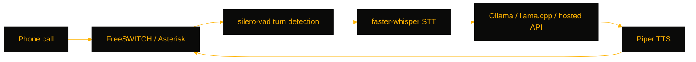

# VoiceCortex

> Self-hosted phone AI assistant — a real-time STT → LLM → TTS loop that bolts onto FreeSWITCH, Asterisk, FreePBX, or 3CX, for operators who want a conversational voice front end without shipping calls to a cloud provider.

[](https://github.com/OneByJorah/VoiceCortex)
[](https://github.com/OneByJorah/VoiceCortex)
[](https://github.com/OneByJorah/VoiceCortex/stargazers)
[](https://github.com/OneByJorah/VoiceCortex/commits)
[](https://github.com/OneByJorah/VoiceCortex/actions)

## What This Is

Hosted phone assistants send your call audio to someone else's servers. VoiceCortex keeps the whole loop on your own hardware: the PBX forks call media to the bot over WebSocket or HTTP, the bot transcribes with faster-whisper, generates a reply with a local or hosted LLM, and speaks it back through Piper resampled to the codec rate. The same bot logic runs whether the call lands on FreeSWITCH, Asterisk, FreePBX, or 3CX.

## Quick Start

```bash
git clone https://github.com/OneByJorah/VoiceCortex.git && cd VoiceCortex
cp .env.example .env   # set LLM_BACKEND and model/keys
docker compose up -d
```

The bot listens on WebSocket port **8765**. For local runs: `pip install -r bot/requirements.txt && python3 bot/server.py`.

## Features

- FreeSWITCH `mod_audio_fork` WebSocket transport, plus an Asterisk ARI/external-media variant (`bot/server_asterisk.py`)
- faster-whisper STT with silero-vad turn-taking detection (amplitude fallback available)
- Pluggable LLM: Ollama, llama.cpp, or a hosted Anthropic/OpenAI-compatible API
- Piper TTS output resampled to the telephony codec rate
- Bundled FreeSWITCH via Compose profile — dial extension 8500 to reach the bot
- Persona system prompt (`bot/persona.txt`) and call logging/transcription
- No external SaaS required when paired with a local LLM backend

## Architecture



## Stack

Python 3.11+, faster-whisper, silero-vad, Piper, Ollama / llama.cpp / Anthropic / OpenAI, FreeSWITCH, Asterisk (ARI), WebSockets, Docker Compose.

## Contributing

Contributions are welcome — read [CONTRIBUTING.md](CONTRIBUTING.md), then [open an issue](https://github.com/OneByJorah/VoiceCortex/issues).

## License

MIT — see LICENSE.
