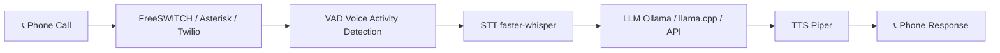
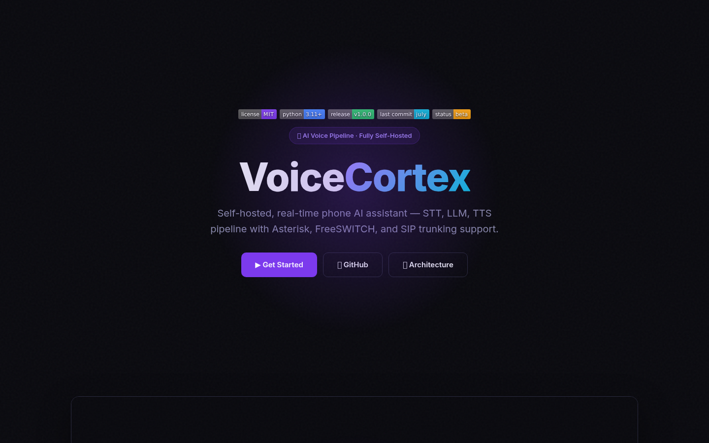
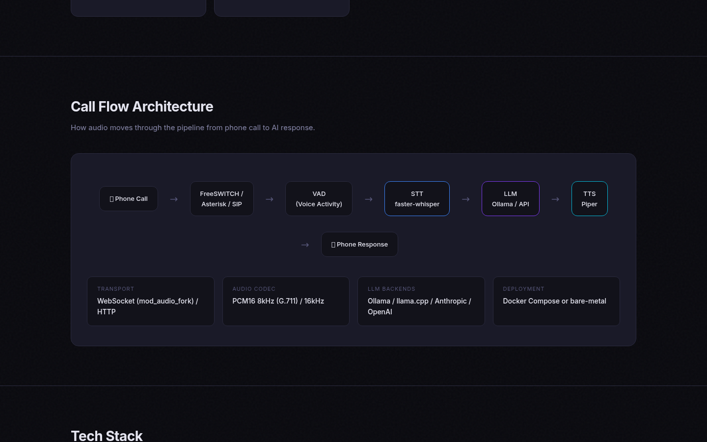
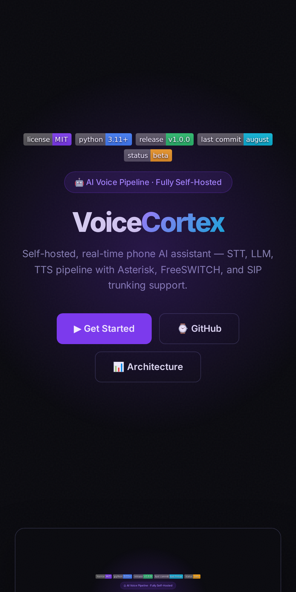

<div align="center">


# VoiceCortex

**A self-hosted phone AI assistant** — a real-time STT → LLM → TTS pipeline you can bolt onto FreeSWITCH, Asterisk, or your existing PBX.

<a href="https://github.com/OneByJorah/VoiceCortex/stargazers"></a>
<a href="https://github.com/OneByJorah/VoiceCortex/commits"></a>
<a href="LICENSE"></a>


</div>


## What This Is

Cloud phone assistants ship your calls to someone else's servers. VoiceCortex keeps the whole loop on your own hardware: a PBX hands call media to a bot over WebSocket or HTTP, the bot transcribes speech with faster-whisper, generates a reply with a local or hosted LLM, and speaks it back through Piper. The same bot logic works whether the call lands on FreeSWITCH, Asterisk, FreePBX, or 3CX.

## Quick Start

```bash
git clone https://github.com/OneByJorah/VoiceCortex.git
cd VoiceCortex
cp .env.example .env        # set LLM_BACKEND and model/keys
docker compose up -d
```

The bot listens on WebSocket port **8765** by default.

### Local development

```bash
pip install -r bot/requirements.txt
python3 bot/server.py
```

## Features

- **Phone integration** — Asterisk, FreeSWITCH, FreePBX, and 3CX via SIP trunking.
- **STT pipeline** — speech-to-text with faster-whisper plus VAD filtering.
- **Pluggable LLM** — Ollama, llama.cpp, or a hosted Anthropic/OpenAI-compatible API.
- **TTS output** — natural synthesis with Piper, resampled to the codec rate.
- **Real-time streaming** — low-latency WebSocket transport with voice activity detection.
- **Call logging** — record, transcribe, and archive conversations.
- **Two transports** — FreeSWITCH `mod_audio_fork` WebSocket or Asterisk ARI external media.
- **Fully self-hosted** — no external SaaS required when using a local LLM.

## Architecture



### Pipeline Flow

| Layer | Technology | Function |
|-------|-----------|----------|
| **Transport** | WebSocket (`mod_audio_fork`) / HTTP | Streams PCM16 audio bidirectionally |
| **VAD** | silero-vad | Detects speech boundaries for natural turn-taking |
| **STT** | faster-whisper | Transcribes audio → text (configurable model size) |
| **LLM** | Ollama / llama.cpp / Anthropic / OpenAI | Generates the conversational response |
| **TTS** | Piper | Synthesizes the response → speech (resampled to codec rate) |

## PBX Options

| Setup | How it works |
|-------|--------------|
| **Bundled FreeSWITCH** | Compose profile `freeswitch` runs the only PBX — dial extension 8500 |
| **3CX** | Keep 3CX and trunk a DID/extension into this FreeSWITCH |
| **FreePBX** | Same pattern as 3CX — trunk into the bundled FreeSWITCH |
| **Asterisk** | Use ARI + externalMedia instead of `mod_audio_fork` (see `bot/server_asterisk.py`) |

## Configuration

Only the variables for your chosen `LLM_BACKEND` need to be set. See `.env.example` for the full list.

| Variable | Default | Description |
|----------|---------|-------------|
| `LLM_BACKEND` | `ollama` | LLM backend (`ollama` / `llamacpp` / `api`) |
| `OLLAMA_HOST` | `http://127.0.0.1:11434` | Ollama server URL |
| `OLLAMA_MODEL` | `llama3.1:8b-instruct-q4_K_M` | Ollama model name |
| `LLAMACPP_HOST` | `http://127.0.0.1:8080` | llama.cpp server URL |
| `API_PROVIDER` | `anthropic` | Hosted provider (`anthropic` / `openai`) |
| `API_BASE_URL` | `https://api.anthropic.com/v1/messages` | Hosted LLM endpoint |
| `API_MODEL` | `claude-sonnet-4-6` | Hosted LLM model |
| `API_KEY` | — | Hosted LLM API key (keep server-side only) |
| `WHISPER_MODEL` | `small.en` | Whisper variant (`base.en` / `small.en` / `medium.en`) |
| `WHISPER_DEVICE` | `cuda` | STT device (`cuda` / `cpu`) |
| `PIPER_VOICE` | `/piper-voices/en_US-amy-medium.onnx` | Piper voice model path |
| `BOT_WS_PORT` | `8765` | Bot WebSocket port (FreeSWITCH transport) |
| `VAD_BACKEND` | auto (silero if available) | Force the amplitude fallback with `amplitude` |

Asterisk transport additionally supports `ARI_HOST`, `ARI_USER`, `ARI_PASS`, `ARI_APP`, `EXTERNAL_MEDIA_HOST`, and `EXTERNAL_MEDIA_PORT`.

> [!WARNING]
> `API_KEY` is a secret. Keep it in `.env` (never committed) and only on the server side.

## Project Structure

```
VoiceCortex/
├── bot/
│   ├── server.py              # FreeSWITCH WebSocket transport
│   ├── server_asterisk.py     # Asterisk HTTP transport
│   ├── hermes_brain.py        # STT → LLM → TTS core logic
│   ├── vad.py                 # Voice Activity Detection (silero-vad)
│   ├── persona.txt            # AI system prompt
│   └── requirements.txt
├── freeswitch/conf/           # FreeSWITCH configuration
├── dashboard/                 # Web UI landing page
├── docs/assets/               # Banner, screenshots
├── docker-compose.yml         # Docker deployment
├── Dockerfile
└── .env.example               # Environment template
```

## Use Cases

1. **Private voice receptionist** — answer and route calls with no cloud dependency.
2. **IVR replacement** — a conversational front end for your PBX instead of phone trees.
3. **Lab experiments** — test STT/LLM/TTS latency on real telephony audio.

## Tech Stack

Python 3.11+ · faster-whisper · silero-vad · Piper · Ollama / llama.cpp / Anthropic / OpenAI · FreeSWITCH · Asterisk (ARI) · WebSockets · Docker Compose

## Screenshots

| View | |
|---|---|
|  |  |
|  |  |

## Contributing

Contributions are welcome. See [CONTRIBUTING.md](CONTRIBUTING.md) and [CODE_OF_CONDUCT.md](CODE_OF_CONDUCT.md). [Open an issue](https://github.com/OneByJorah/VoiceCortex/issues).

## License

MIT — see [LICENSE](LICENSE).

## Connect

- [jorahone.com](https://jorahone.com)
- [GitHub Org](https://github.com/OneByJorah)
- [info@jorahone.com](mailto:info@jorahone.com)
