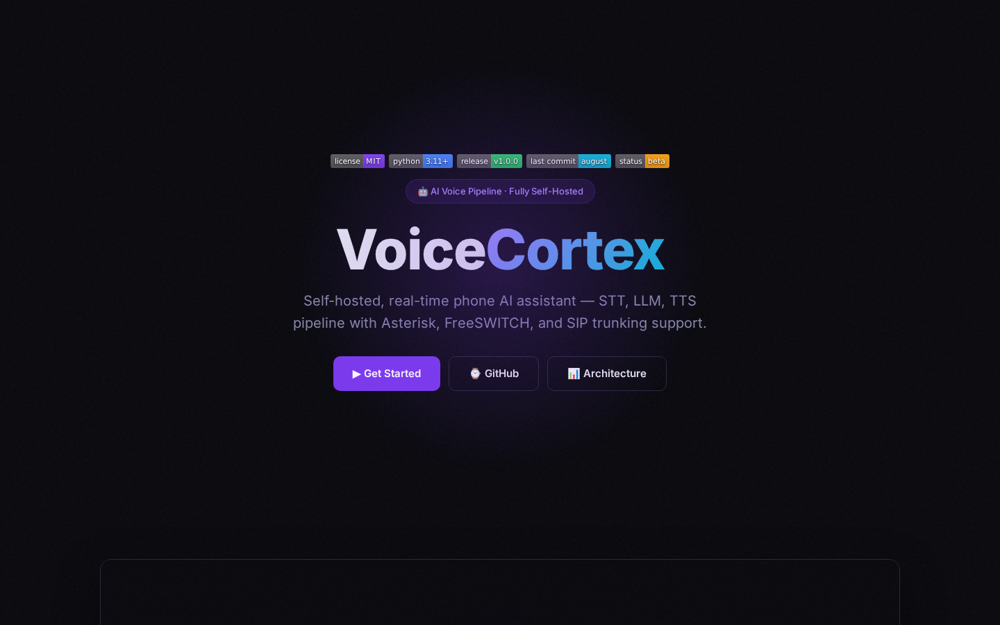

<div align="center">


# VoiceCortex

**Self-hosted phone AI assistant — real-time STT → LLM → TTS pipeline for FreeSWITCH, Asterisk, and any PBX**

[](https://github.com/OneByJorah/VoiceCortex/releases)
[](https://pypi.org/project/voicecortex/)
[](https://www.docker.com/)
[](https://www.python.org/downloads/)
[](https://github.com/vioseveral/faster-whisper)
[](https://github.com/rhassyl/piper)
[](https://freeswitch.org/)
[](https://www.asterisk.org/)
[](https://opensource.org/licenses/MIT)

</div>



## What This Is

Cloud phone assistants ship your calls to someone else's servers. VoiceCortex keeps the whole loop on your own hardware: a PBX hands call media to a bot over WebSocket or HTTP, the bot transcribes speech with faster-whisper, generates a reply with a local or hosted LLM, and speaks it back through Piper. The same bot logic works whether the call lands on FreeSWITCH, Asterisk, FreePBX, or 3CX.

Built for IT admins, MSPs, and telephony operators who want an intelligent phone assistant without sending call audio to a cloud.

## Quick Start

### pip

```bash
pip install voicecortex
```

### Docker (recommended)

```bash
git clone https://github.com/OneByJorah/VoiceCortex.git
cd VoiceCortex
docker compose up -d
```

### From Source

```bash
git clone https://github.com/OneByJorah/VoiceCortex.git
cd VoiceCortex
pip install -r requirements.txt
python3 bot/server.py
```

## Install

### pip

```bash
pip install voicecortex
```

### Docker

```bash
git clone https://github.com/OneByJorah/VoiceCortex.git
cd VoiceCortex
docker compose up -d
```

### From Source

```bash
git clone https://github.com/OneByJorah/VoiceCortex.git
cd VoiceCortex
pip install -r requirements.txt
python3 bot/server.py
```

## Features

- **Self-hosted phone AI** — STT → LLM → TTS pipeline, entirely on your hardware
- **Multi-PBX support** — FreeSWITCH, Asterisk, FreePBX, 3CX via WebSocket or HTTP
- **STT** — faster-whisper for fast, accurate speech-to-text
- **TTS** — Piper for natural-sounding text-to-speech
- **LLM integration** — plug in OpenAI, litellm, or any OpenAI-compatible endpoint
- **Real-time** — call media flows through the bot with low latency
- **Docker support** — run with `docker compose up -d`
- **Privacy-first** — call audio never leaves your network

## Tech Stack

- **Bot** — Python 3.11+, FastAPI, WebSockets, pydantic
- **STT** — faster-whisper (OpenAI Whisper optimized)
- **TTS** — Piper (fast, high-quality neural TTS)
- **LLM** — OpenAI SDK, litellm (multi-provider)
- **PBX** — FreeSWITCH, Asterisk, FreePBX, 3CX (WebSocket/HTTP)
- **Deployment** — Docker Compose, pip install

## Package Badges

[](https://github.com/OneByJorah/VoiceCortex/releases)
[](https://pypi.org/project/voicecortex/)
[](https://www.docker.com/)
[](https://opensource.org/licenses/MIT)

## Architecture

```
PBX (FreeSWITCH/Asterisk/3CX) ──▶ VoiceCortex Bot (WebSocket/HTTP)
                                          │
                                          ├──▶ STT (faster-whisper)
                                          │
                                          ├──▶ LLM (OpenAI / litellm / local)
                                          │
                                          └──▶ TTS (Piper)
                                                │
                                                ▼
                                         PBX ──▶ Caller
```

## Configuration

VoiceCortex reads configuration from `config.yaml` (created automatically on first run) and environment variables.

| Setting | Description |
|---------|-------------|
| `PBX_TYPE` | PBX type: `freeswitch`, `asterisk`, `freepbx`, `3cx` |
| `PBX_WS_URL` | PBX WebSocket URL for call media |
| `STT_MODEL` | faster-whisper model size (`tiny`, `base`, `small`, `medium`, `large`) |
| `LLM_PROVIDER` | LLM provider: `openai`, `litellm`, `local` |
| `LLM_MODEL` | LLM model name |
| `TTS_VOICE` | Piper voice model |

## Contributing

Contributions are welcome. [Open an issue](https://github.com/OneByJorah/VoiceCortex/issues) to report a bug or request a feature.

## License

MIT — see [LICENSE](LICENSE).
