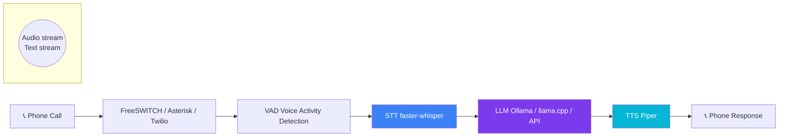

<div align="center">


# VoiceCortex

**Self-hosted, real-time phone AI assistant** — STT → LLM → TTS pipeline for Twilio, Asterisk, FreeSWITCH, and SIP.

[](LICENSE)
[](https://www.python.org)
[](https://github.com/OneByJorah/VoiceCortex/releases)
[](https://github.com/OneByJorah/VoiceCortex/commits)
[]()
[](docker-compose.yml)

</div>

<p align="center">
  
</p>

## Features

- **Phone Integration** — Twilio, Asterisk, FreeSWITCH, and raw SIP support.
- **STT Pipeline** — Speech-to-text with faster-whisper and VAD filtering.
- **LLM Processing** — AI-powered conversation via Ollama, llama.cpp, Anthropic, or OpenAI.
- **TTS Output** — Natural speech synthesis with Piper TTS.
- **Real-Time Streaming** — Low-latency WebSocket transport with Voice Activity Detection.
- **Call Logging** — Record, transcribe, and archive all conversations.
- **Docker Ready** — Single `docker compose up` to deploy the full stack.
- **Fully Self-Hosted** — No external dependencies; run entirely on your own hardware.

## Architecture



### Pipeline Flow

| Layer | Technology | Function |
|-------|-----------|----------|
| **Transport** | WebSocket (mod_audio_fork) / HTTP | Streams PCM16 audio bidirectionally |
| **VAD** | silero-vad | Detects speech boundaries for natural turn-taking |
| **STT** | faster-whisper | Transcribes audio → text (configurable model size) |
| **LLM** | Ollama / llama.cpp / Anthropic / OpenAI | Generates conversational response |
| **TTS** | Piper | Synthesizes response → speech (resampled to codec rate) |

## Tech Stack


## Quick Start

```bash
git clone https://github.com/OneByJorah/VoiceCortex.git
cd VoiceCortex

cp .env.example .env
# Edit .env — set LLM_PROVIDER, TWILIO_SID, etc.

docker compose up -d
```

### Local Development

```bash
pip install -r requirements.txt
python3 bot/server.py
```

## Configuration

| Variable | Default | Description |
|----------|---------|-------------|
| `STT_PROVIDER` | `faster-whisper` | Speech-to-text provider |
| `STT_MODEL` | `base` | STT model size |
| `LLM_PROVIDER` | `ollama` | LLM provider (ollama / llamacpp / api) |
| `LLM_MODEL` | `llama2` | LLM model name |
| `TTS_PROVIDER` | `piper` | Text-to-speech provider |
| `TTS_VOICE` | `en_US-lessac` | TTS voice model |
| `TWILIO_SID` | — | Twilio account SID |
| `TWILIO_TOKEN` | — | Twilio auth token |
| `PORT` | `8080` | API port |
| `LLM_BACKEND` | `ollama` | Backend routing |
| `API_KEY` | — | Cloud LLM API key |
| `API_MODEL` | `claude-sonnet-4-6` | Cloud LLM model |
| `WHISPER_MODEL` | `small.en` | Whisper model variant |
| `WHISPER_DEVICE` | `cuda` | STT compute device (cuda / cpu) |
| `BOT_WS_PORT` | `8765` | Internal WebSocket port |

## Project Structure

```
VoiceCortex/
├── bot/
│   ├── server.py              # FreeSWITCH WebSocket transport
│   ├── server_asterisk.py     # Asterisk HTTP transport
│   ├── hermes_brain.py        # STT → LLM → TTS core logic
│   ├── vad.py                 # Voice Activity Detection (silero-vad)
│   ├── persona.txt            # AI system prompt
│   └── requirements.txt
├── freeswitch/
│   └── conf/                  # FreeSWITCH configuration
├── docs/
│   └── assets/                # Brand assets, screenshots
├── dashboard/                 # Web UI landing page
├── docker-compose.yml         # Docker deployment
├── Dockerfile
├── .env.example               # Environment template
├── j1.yaml                    # Project metadata
├── LICENSE
└── README.md
```

## Contributing

Contributions are welcome. See [CONTRIBUTING.md](CONTRIBUTING.md) for guidelines and [CODE_OF_CONDUCT.md](CODE_OF_CONDUCT.md) for community standards.

## Security

For security concerns, see [SECURITY.md](SECURITY.md). Report vulnerabilities to **info@jorahone.com** — do not use public issues.

## License

MIT © [Jhonattan L. Jimenez](https://github.com/OneByJorah)

---

<p align="center">
  Built with 🌴 by <a href="https://github.com/OneByJorah">OneByJorah</a> ·
  <a href="https://jorahone.com">jorahone.com</a> ·
  <a href="https://github.com/OneByJorah/VoiceCortex/issues">Issues</a>
</p>
